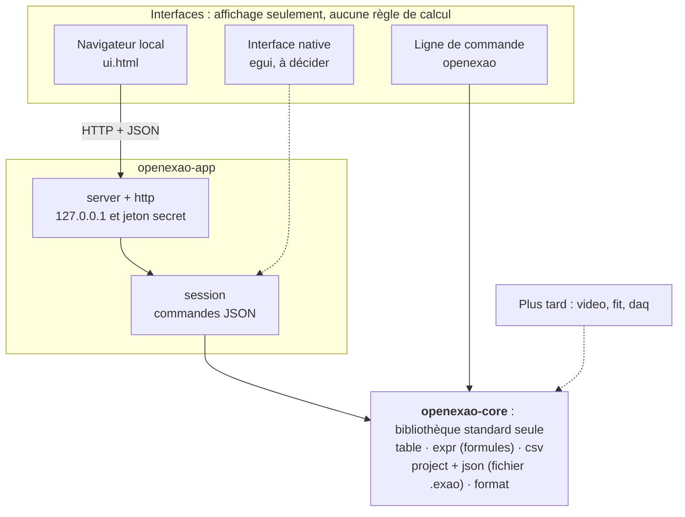

# Architecture d'Open-ExAO (preuve de concept)

Version du prototype : 0.0.1 · tableur seul · mise à jour le 5 novembre 2026

Open-ExAO vise à devenir un logiciel libre d'expérimentation assistée par ordinateur
(pointage vidéo, acquisition, modélisation), équivalent aux usages de l'Atelier Scientifique
de Jeulin sans en reprendre ni le code, ni le nom, ni l'aspect. Ce document décrit
l'architecture du premier prototype, qui ne gère qu'un **tableur de mesures**, et ce qu'il
faut décider avant d'aller plus loin.

## 1. Ce que prouve (et ne prouve pas) ce prototype

Il prouve que :

- un noyau Rust, indépendant de toute interface, gère un tableau de mesures, des colonnes
  calculées par formules (recalculées dans l'ordre des dépendances, erreurs signalées par
  cellule), l'import et l'export CSV à la française, et un fichier de projet versionné ;
- ce même noyau sert deux interfaces, un navigateur local et une ligne de commande, sans
  que les règles de calcul soient écrites deux fois ;
- l'ensemble tient dans la bibliothèque standard de Rust, sans dépendance externe.

Il ne prouve pas : les graphiques, la vidéo, l'acquisition sur capteurs, la tenue sur de
gros volumes, l'ergonomie en classe avec des élèves, ni le choix définitif de la
technologie d'interface (voir le point D3 du §6).

## 2. Vue d'ensemble



Les flèches pointillées sont prévues, pas construites.

## 3. Le noyau (`crates/core`)

| Module | Rôle |
| --- | --- |
| `table` | Tableau de colonnes nommées : colonnes de données (saisies ou importées) et colonnes calculées. Recalcul automatique après chaque modification. |
| `expr` | Lecture (parser) et évaluation des formules. |
| `csv` | Import (séparateur détecté, virgule décimale acceptée) et export. |
| `project`, `json` | Fichier de projet `.exao`, document JSON versionné. |
| `format` | Lecture et affichage des nombres, à la française par défaut. |
| `sample` | Jeu de données d'exemple (chute libre). |

**Cellules.** Une cellule est vide, ou un nombre, ou une erreur (`Empty`, `Num`, `Err`).
Un nombre est toujours fini : un résultat infini ou indéfini devient une erreur de cellule,
jamais une valeur silencieuse.

**Recalcul.** Chaque colonne calculée dépend d'autres colonnes par leur nom. Le tableau
est évalué dans l'ordre des dépendances ; les dépendances circulaires sont détectées et
marquées « Dépendance circulaire » sur les colonnes concernées. Une formule fausse ne
bloque rien : la colonne existe, ses cellules sont en erreur et le message est affiché sous
la formule (comme un `#NOM?` de tableur).

**Formules.** Nombres (`3`, `0.5`, `1e-3`), noms de colonnes, `+ - * / ^`, parenthèses,
fonctions `sqrt abs sin cos tan asin acos atan atan2 exp ln log10 pow min max` et la
constante `pi`. Le séparateur décimal des formules est le point. Précédence : `^`
(associatif à droite) avant `* /` avant `+ -`, et `-2^2` vaut `-4`. Un nom de colonne est
un identifiant (lettres, chiffres et `_`, sans commencer par un chiffre), unique dans le
tableau. Les formules s'appliquent **ligne par ligne** : voir D4 pour la suite.

**Formats de fichiers**

- CSV français : séparateur `;`, virgule décimale. CSV international : `,` et point. À
  l'import, la première ligne est l'en-tête (`t (s)` ou `t [s]` donne la colonne `t`
  d'unité `s`) ; une cellule non numérique devient vide et est signalée. L'interface lit
  l'UTF-8 et, à défaut, le windows-1252 (« ANSI » d'Excel sous Windows).
- Projet `.exao`, schéma 1 :

```json
{
  "format": "open-exao",
  "schema": 1,
  "title": "Chute libre",
  "table": {
    "rows": 3,
    "columns": [
      { "name": "t", "unit": "s", "values": [0, 0.1, null] },
      { "name": "y_th", "unit": "m", "formula": "0.5*9.81*t^2" }
    ]
  }
}
```

Seules les colonnes de données stockent des valeurs ; les colonnes calculées sont
recalculées à l'ouverture. Un fichier d'un schéma plus récent que celui que connaît le
logiciel est refusé avec un message explicite.

## 4. L'application locale (`crates/app`)

**Session.** `Session` porte le projet ouvert et applique des **commandes JSON**
(`set_cell`, `paste`, `add_row`, `remove_row`, `add_data_column`, `add_computed_column`,
`remove_column`, `rename_column`, `set_unit`, `set_formula`, `set_title`, `new`, `demo`,
`open`). Elle ne contient aucune règle de calcul : elle traduit chaque commande en appel
au noyau et décrit le résultat pour l'affichage (`snapshot`). Une commande refusée laisse
le tableau inchangé et renvoie un message en français.

**Serveur.** Un serveur HTTP minimal, écrit pour l'occasion, sert la page et une petite
API (`GET /api/state`, `POST /api/command`, `GET /api/export`). Comme il modifie des
données et lit des fichiers envoyés par le navigateur, une page web quelconque ne doit pas
pouvoir lui parler :

- écoute sur `127.0.0.1` uniquement ;
- un jeton secret de 128 bits, tiré à chaque lancement, est exigé : dans l'adresse pour la
  page et les téléchargements, dans l'en-tête `X-Exao-Token` pour l'API ;
- l'en-tête `Host` doit être `127.0.0.1:port` ou `localhost:port` (contre le « DNS
  rebinding ») ;
- aucun chemin de fichier n'est accepté de l'extérieur : l'ouverture envoie le contenu du
  fichier, l'enregistrement est un téléchargement du navigateur ;
- limites : corps de 16 Mo, 64 connexions simultanées, délais de lecture et d'écriture.

**Interface.** `ui.html` est une page unique, sans bibliothèque ni appel réseau externe.
Elle construit les éléments sans jamais passer par `innerHTML` : le contenu des fichiers
(noms de colonnes, unités) est toujours traité comme du texte.

## 5. Règles à respecter

1. Aucune règle de calcul hors du noyau, ni dans la session, ni dans une interface.
2. Une commande est atomique : si elle est refusée, rien ne change.
3. Une erreur de calcul reste dans sa cellule ; le logiciel ne plante pas et n'affiche
   jamais un nombre non fini.
4. Un fichier est versionné ; on ne stocke jamais de valeurs calculées ; un fichier trop
   récent est refusé clairement.
5. Les données d'élèves restent sur l'ordinateur : aucune connexion sortante, serveur local
   limité à `127.0.0.1`.
6. Le noyau reste sans dépendance externe tant que c'est raisonnable (audit, portabilité
   vers WebAssembly).

## 6. Décisions et points à trancher

| N° | Sujet | État | Raison et condition de révision |
| --- | --- | --- | --- |
| D1 | Noyau séparé de toute interface | Prise | Permet de changer d'interface sans réécrire les règles ; testé par deux interfaces. |
| D2 | Aucune dépendance externe dans le prototype | Prise pour le prototype | L'environnement où il a été écrit n'accède pas à crates.io ; cela garde aussi le noyau facile à auditer. À revoir dès qu'on a besoin d'egui, d'un décodeur vidéo ou de zip. Le JSON et le CSV écrits à la main pourraient alors être remplacés par des bibliothèques établies si cela réduit le code à maintenir. |
| D3 | Technologie d'interface | **Provisoire** | L'étude recommandait egui. Il n'a pas pu être compilé ici (pas d'accès à crates.io) ; le prototype passe donc par un navigateur local. Hypothèse à tester en phase 0 : la lecture image par image d'une vidéo, avec une position exacte, est plus fragile dans un navigateur que par un décodeur natif. Si l'essai le confirme, bascule vers egui avec décodage natif ; le noyau et la session ne changent pas. |
| D4 | Formules ligne par ligne | À trancher avant v0.3 | La vitesse est la dérivée de la position, et une moyenne porte sur une colonne entière : cela demande des fonctions de colonne (`deriv(y, t)`, `mean(y)`), donc une évaluation sur des colonnes complètes. C'est la principale évolution à prévoir dans `expr`. |
| D5 | Format du fichier de projet | À trancher en phase 2 | Le JSON seul suffit tant qu'il n'y a pas de vidéo. Avec la vidéo : archive zip (projet et vidéo ensemble) ou JSON avec référence au fichier vidéo. |
| D6 | Licence et nom | Ouverts | Licence à choisir (permissive ou GPL). « Open-ExAO » est un nom provisoire, disponibilité non vérifiée (INPI, GitHub, crates.io). |

## 7. Limites connues du prototype

- Écrit et testé sous Linux. Le lancement automatique du navigateur sous Windows et macOS
  est prévu dans le code mais n'a pas été essayé ; l'adresse est de toute façon affichée
  dans le terminal.
- Pas d'annuler/rétablir. Une valeur refusée revient à la valeur valide quand on quitte la
  cellule.
- Pas de graphique, pas de sélection de plages, pas de fonctions de colonne (D4).
- L'affichage reconstruit toute la grille à chaque commande. Mesuré avec une version de
  développement et un Chromium sans écran (ordre de grandeur) : environ 0,2 s par
  modification à 500 lignes, 0,5 s à 2 000 lignes, 3 à 4 s à 10 000 lignes. Cela suffit pour
  une acquisition de TP ; au-delà, il faudra n'afficher que les lignes visibles.
- Aucun test d'accessibilité (lecteur d'écran, navigation complète au clavier) ni test avec
  des élèves.
- Un seul projet ouvert par lancement, partagé entre les onglets du navigateur.

## 8. Étapes suivantes (en lien avec la feuille de route)

1. **Phase 0, à terminer** : essai de lecture vidéo image par image (tranche D3), choix du
   nom et de la licence, audit des usages avec la grille d'audit.
2. **v0.1** : graphiques interactifs (courbes, nuage de points, zoom, réticule),
   annuler/rétablir (historique de commandes dans `Session`), fonctions de colonne (D4).
3. **v0.2** : nouvelle crate `video` derrière un trait `VideoSource`, étalonnage, pointage
   manuel, envoi des points vers le tableau.
4. **v0.3** : crate `fit` (moindres carrés avec incertitudes), grandeurs dérivées, rapport
   exportable, test en classe.
5. **v0.5** : crate `daq` derrière un trait `Instrument` (Arduino, ESP32, Bluetooth).

## 9. Vérifier le projet

```text
cargo test --workspace                 # 80 tests : noyau, session, serveur sur vraie connexion TCP
cargo clippy --workspace --all-targets -- -D warnings
cargo fmt --all -- --check
```

Un scénario de navigateur (22 vérifications : modification de cellule, valeur refusée,
colonne calculée, formule fausse, exports, réouverture du projet) est dans
`tests/ui/scenario.js` ; il demande Node et Playwright, et sert à contrôler l'interface
après une modification de `ui.html`.
